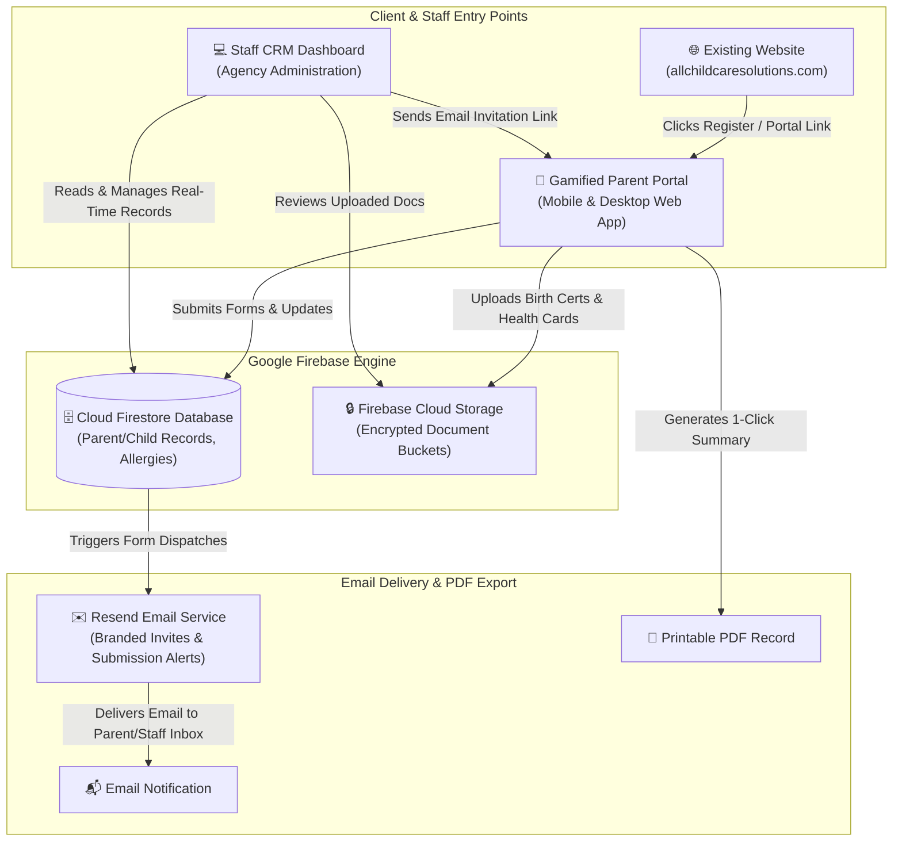

# Custom Child Care CRM & Admissions Platform Proposal

**Prepared for:** Jonathan | All Child Care Solutions  
**Website:** [https://allchildcaresolutions.com/](https://allchildcaresolutions.com/)  
**Prepared by:** Jared (Software Development & Solutions Architecture)  
**Date:** August 8, 2026  
**Agreed Investment:** $1,500 (Custom CRM & Parent Portal Package)  

---

## 1. Executive Summary & Project Vision

All Child Care Solutions is replacing fragmented phone inquiries, paper PDFs, and legacy Jotforms with a custom, unified **Admissions CRM & Parent Portal Platform**.

For an agreed fixed investment of **$1,500**, we are engineering a modern, secure web software application tailored to your agency's exact workflow. Powered by **Google Firebase**, this platform gives your team a single centralized staff dashboard to manage parents, children, document uploads, allergies, and care requirements, while providing parents with an intuitive, gamified online registration portal.

---

## 2. Core Platform Capabilities ($1,500 Scope)

```
┌──────────────────────────────────────────────────────────────────────────────────┐
│                             STAFF CRM DASHBOARD                                  │
│  - Centralized Family & Child Database (Parents, Children, Medical, Allergies)   │
│  - Interactive Form Dispatcher (Send single-click registration links via email)  │
│  - Document Management Center (Birth Certificates, Health Cards, Immunizations) │
└──────────────────────────────────────────────────────────────────────────────────┘
                                        ▲
                                        │  Real-Time Firestore Sync
                                        ▼
┌──────────────────────────────────────────────────────────────────────────────────┐
│                    GAMIFIED PARENT REGISTRATION PORTAL                           │
│  - Secure Parent Login & Authenticated Portal Access                             │
│  - Step-by-Step Progress Map (Parent Info -> Child Info -> Documents -> Sign)   │
│  - Mobile-Responsive Document Uploads & Save-and-Resume Progress                 │
└──────────────────────────────────────────────────────────────────────────────────┘
```

### Key Features Included:

#### 1. Centralized Staff CRM Dashboard & Database
- **Unified Family Records**: Single dashboard tracking parents and their children in one database view powered by Google Firestore.
- **Child Health & Medical Tracking**: Organized view of child birth dates, allergies, dietary needs, routines, and emergency contacts.
- **Document Management Center**: Store, review, approve, or request replacements for child birth certificates, health cards, and immunization records securely stored in Firebase Cloud Storage.

#### 2. Interactive Form Dispatches & Submission Flows
- **One-Click Form Dispatch**: Staff can send interactive registration form links directly to parents via email (powered by Resend API) or copy direct URLs.
- **Automated CRM Sync**: Form submissions automatically parse, format, and save directly into the staff database in real time—eliminating manual data entry entirely.

#### 3. Gamified Parent Registration Portal
- **Gamified Progress-Mapped Interface**: Visual step-by-step progress bar (e.g., *Step 1: Guardian Contact ➔ Step 2: Child Profile ➔ Step 3: Medical & Allergies ➔ Step 4: Document Uploads ➔ Step 5: E-Signature & Submission*).
- **Save & Resume**: Parents can complete registration in one sitting or save progress and return later on any mobile phone, tablet, or desktop.
- **Instant Printable PDF Record**: Completed submissions generate a clean formatted summary page with 1-click **"Print / Download PDF"** functionality.

---

## 3. Financial & Payment Milestone Terms

The agreed fixed investment of **$1,500** is divided into three equal payments aligned with clear project milestones:

| Milestone / Payment | Amount | Trigger / Deliverable |
| :--- | :--- | :--- |
| **Payment 1: Kickoff Deposit** | **$500** | Project initiation & Morning Kickoff Workshop. |
| **Payment 2: Mockup Approval** | **$500** | Upon interactive UI design & gamified mockup review/approval. |
| **Payment 3: Launch & Handoff** | **$500** | Upon final testing, production launch, staff training & handoff. |
| **Total Fixed Investment** | **$1,500** | **Zero hidden fees or extra setup costs.** |

---

## 4. 3-Week Implementation Roadmap

The project follows a structured 3-week delivery schedule starting with an in-person or virtual Morning Kickoff Workshop:

| Timeline | Phase / Milestone | Detailed Engineering Work & Deliverables |
| :--- | :--- | :--- |
| **Week 1** | **Discovery & Mockup Approval** | • **Morning Kickoff Workshop:** Sit down together in the morning to review all intake requirements, current forms/Jotforms, child medical & allergy categories, document verification rules, and parent portal flows in detail.<br>• **Firebase Infrastructure & Schema:** Initialize Google Firebase project (Hosting, Cloud Firestore database rules, Storage buckets for birth certs/health cards, Auth roles).<br>• **Interactive Mockup Design:** Build UI wireframe mockups for Staff CRM Dashboard & Gamified Parent Portal progress stepper.<br>➔ **Milestone:** Mockup Presentation & Approval (**$500 Payment 2**). |
| **Week 2** | **Parent Portal & Document Engine** | • **Gamified Parent Registration Portal:** Engineer mobile-first step-by-step registration portal (*Guardian Contact ➔ Child Profile ➔ Medical & Allergies ➔ E-Sign*) with save-and-resume progress.<br>• **Document Upload & PDF Generator:** Implement Firebase Storage uploaders for birth certificates & health cards + 1-click printable summary PDF generator. |
| **Week 3** | **Staff CRM & Production Launch** | • **Staff CRM Dashboard & Email Dispatcher:** Build central staff database dashboard, child health drawer, document review controls, and 1-click Resend email form link dispatcher.<br>• **Testing, Training & Production Launch:** Full UAT testing with Jonathan, staff training, custom domain launch on Firebase Hosting, and GitHub repository handover.<br>➔ **Milestone:** Final Production Launch (**$500 Payment 3**). |

---

## 5. Technical Stack (Google Firebase Engine)

- **Frontend & UI**: Next.js / React + TypeScript + Tailwind CSS.
- **Database**: Google Cloud Firestore (Real-time NoSQL database).
- **File Storage**: Firebase Cloud Storage (Encrypted file storage for birth certificates & health cards).
- **Authentication**: Firebase Auth (Secure staff logins & parent portal verification).
- **Email Dispatch**: Resend API for sending branded form invitations and staff notifications.
- **Warranty**: **1-Year Limited Warranty** included standard. Optional $100/mo priority retainer or $80/hr ad-hoc for future feature expansions.

---

## 6. How Your System Works (Technical Overview for Non-Tech Clients)

This diagram shows how your current website, parents, agency staff, email notifications, and Google Firebase database connect in real time:



---

**Prepared by:** Jared | Lead Solutions Architect  
**Client:** Jonathan | All Child Care Solutions ([https://allchildcaresolutions.com/](https://allchildcaresolutions.com/))  
